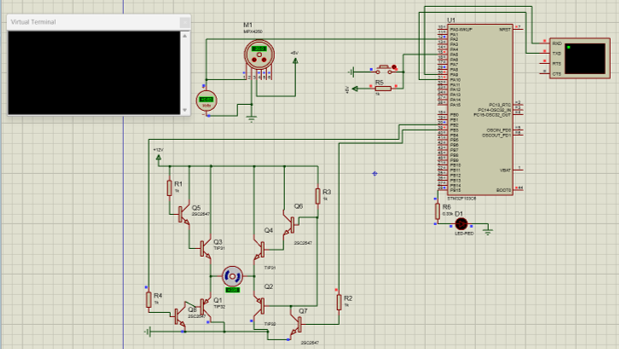
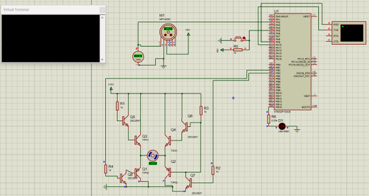
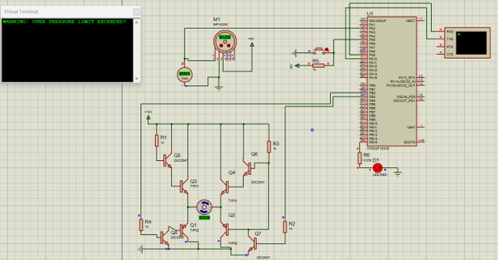

# STM32F103 Pressure-Based Fluid Level Control & Emergency Safety System

This project implements a closed-loop pressure-dependent DC motor speed control and dual-layer safety system using an **STM32F103C6** microcontroller. Developed in **STM32CubeIDE** and simulated in **Proteus**, the system optimizes power consumption via sleep modes (`__WFI()`) and ensures hardware/software fault protection.

---

## ⚙️ System Architecture & Peripherals

* **Microcontroller:** STM32F103C6 (ARM Cortex-M3)
* **Pressure Sensor (ADC1):** Reads analog output (`0.26V – 4.87V`) from an **MPX4250AP** pressure sensor with **12-bit resolution**.
* **Motor Control (TIM2 - PWM):** Generates a **16-bit resolution (0–65535)** PWM signal to drive a BJT H-Bridge motor driver. Due to the inverted logic of the current driver topology, `0` corresponds to full speed and `65535` stops the motor.
* **Low-Power Sampling (TIM3 & `__WFI()`):** Instead of continuous polling, the CPU enters sleep mode using `__WFI()` (Wait For Interrupt) and wakes up every **50 ms** via a TIM3 interrupt to sample ADC data.
* **Hardware Emergency Stop (EXTI):** An external interrupt (`HAL_GPIO_EXTI_Callback`) immediately halts the system regardless of pressure levels when the emergency button is pressed.
* **Diagnostics (UART):** Sends real-time safety alerts to a Virtual Terminal.

---

## 🧪 Simulation Scenarios & Results

### 1. Low Pressure – High Motor Speed (Normal Operation)
When tank pressure is low, the motor runs at high RPM to rapidly fill the system. The warning LED remains OFF.
> 

### 2. High Pressure – Low Motor Speed (Normal Operation)
As pressure increases, the PWM duty cycle adjusts inversely, gradually slowing down the motor.
> 

### 3. Critical Over-Pressure Protection (> 200 kPa)
If the sensor reading reaches or exceeds **200 kPa**, software protection triggers immediately:
* Motor is locked/stopped.
* Red Warning LED turns ON.
* UART transmits: `WARNING: OVER PRESSURE LIMIT EXCEEDED!`
* Automatically recovers once pressure drops below the threshold.
> 

### 4. Hardware Emergency Stop (EXTI)
Pressing the external Emergency Stop button triggers an EXTI interrupt:
* Motor stops immediately.
* Red Warning LED turns ON.
* UART transmits: `EMERGENCY STOP ACTIVATED`
* System resumes normal operation when the button is released.
> 

---

## 🚀 Future Improvements

* **Hardware Driver Topology Optimization (Non-Inverted Logic):** Redesigning the BJT H-Bridge driver stage (or migrating to an integrated active-high MOSFET gate driver) so that the PWM duty cycle scales directly with motor speed (`0` = Stop, `65535` = Full Speed). This eliminates the need for inverted PWM mapping in firmware and improves fail-safe behavior during microcontroller reset or high-impedance states.

---

## 🛠️ Tools Used
* **Firmware Development:** STM32CubeIDE
* **Circuit Design & Simulation:** Proteus 8 Professional

---

## 📚 Acknowledgments & References
* The hardware topology and simulation concept for this project were inspired by and adapted from Marwen Maghrebi's [Advanced-STM32-Simulations](https://github.com/marwen-maghrebi/Advanced-STM32-Simulations-/tree/main) repository.
